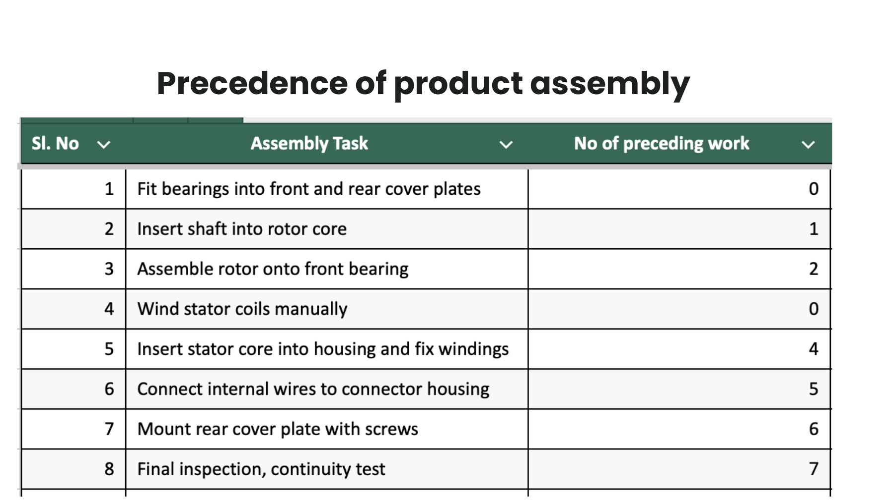
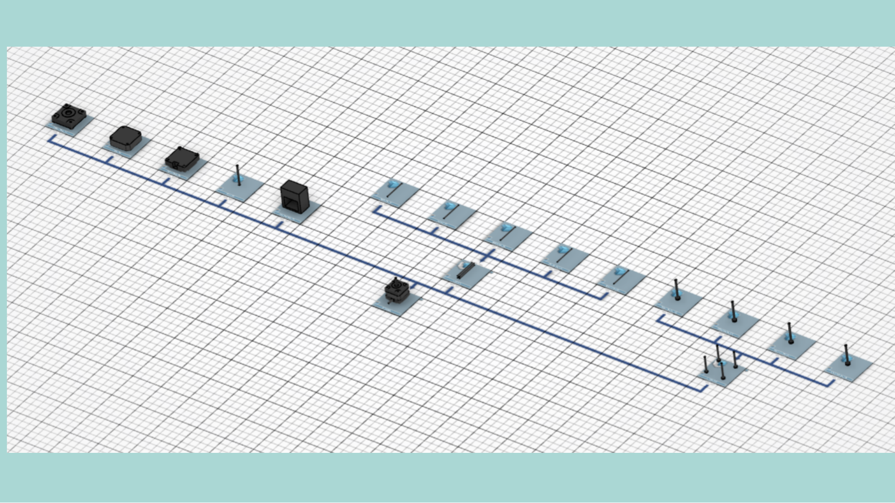
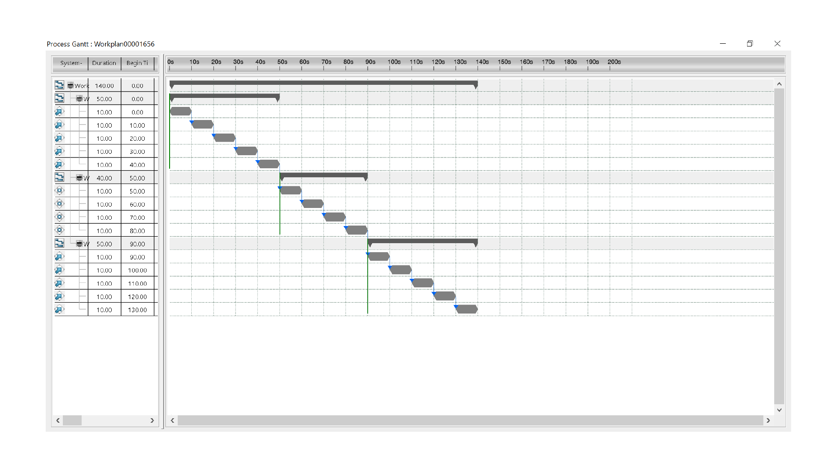

# Stepper Motor Virtual Assembly in DELMIA

Individual course project (Product and Industrial Engineering, PIE), Shiv Nadar University.

## What it is
A 14-part stepper motor assembled virtually in DELMIA (Dassault Systemes) to practise assembly planning, bill of materials and time study.

## What I did
1. Chose the product (stepper motor) and listed its 14 parts in a bill of materials.
2. Planned the assembly sequence with precedence relationships and tools.
3. Loaded the CAD models into DELMIA, divided them into assemblies and sub-assemblies, and defined the process flow.
4. Built the virtual assembly, checked the movements and assembly times, and prepared a Gantt chart of the planned assembly sequence.

## Assembly precedence

## DELMIA process flow and Gantt chart

## What I learned
Method study and time study, bill of materials and assembly sequence, precedence relationships, and an introduction to assembly line balancing.

## Status
Academic project. The Gantt chart shows planned task durations in the simulation, not measured real assembly times, and no physical build or validation is claimed. No cost results are reported.
